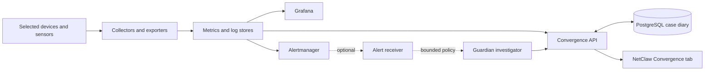

# Convergence for NetClaw

Convergence brings network observations, service health and investigation cases
into NetClaw's **Convergence** tab. Start with the monitoring services, connect the
sources you want to observe, then optionally add bounded agent investigations.
You do not need model credentials or network-device access to try the core stack.

For rental lab VMs, see the [host telemetry prototype](convergence/rental-vm-telemetry.md).
It provides heartbeat ingestion and operator Security-view visibility for approved
trials; customer rollout and trusted hypervisor boundary collection are separate
qualification steps.

## Choose your installation

| Path | Choose this when | Guide |
|---|---|---|
| **Home-lab flow demo — Linux Docker** | You want retained traffic evidence without special network equipment, followed by optional local-interface monitoring | [Start on a home network](convergence/home-lab.md) |
| **K3s + Helm — recommended** | You want a persistent installation with VictoriaMetrics, VictoriaLogs, Loki, an OpenTelemetry collector and repeatable upgrades | [Install on K3s](convergence/k3s.md) |
| **Docker Compose — local trial** | You want to try the API, case diary, Prometheus and a health dashboard on one computer | [Try with Docker](convergence/docker.md) |
| Existing installation | You already have data, credentials or shared Grafana | [Operate, upgrade and reuse](convergence/operations.md) |

Both fresh paths generate private credentials, support your own site name and
keep access local or cluster-internal by default. K3s includes an optional private
Grafana; an existing shared Grafana can be connected without replacing its other
dashboards. Docker is a smaller trial, not the full Victoria/IDS installation. Its optional
flow path adds retained traffic evidence without requiring Cisco equipment,
Proxmox or Kubernetes. Demonstration data and local-interface observations are
explicitly labeled; neither establishes whole-network coverage.

**Start here:** clone a release of this repository, then follow one guide:

```bash
git clone --branch v0.1.0 https://github.com/byrn-baker/convergence-platform.git convergence
cd convergence
```

The [verification record](convergence/verification.md) distinguishes executed
platform tests from documentation-only guidance.

## Ask NetClaw to install it

NetClaw's `convergence-setup` skill follows the [setup procedures](convergence/setup/)
in this repository. It asks for what it cannot discover, shows the plan before
changing anything, installs the selected stack and verifies it. Example requests:

> Set up Convergence on my K3s cluster. Use context `lab`, namespace
> `convergence`, site `office`, and storage class `local-path`. Use a separate
> Grafana for now. Inspect existing resources before installing.

> Build a three-node K3s cluster on my Proxmox server for Convergence and manage it
> with Argo CD.

> Help me try Convergence with the Linux Docker flow demonstration. I have no
> managed switch or hypervisor. Keep example traffic separate from my actual network.

Without NetClaw, any coding agent can follow the same procedures:

> Read `docs/convergence/setup/` and install Convergence for this environment.
> Verify the installation and leave a short handover.

Setup needs the same Docker, Kubernetes or Proxmox access you would use manually.
Installing the monitoring stack does not grant permission to reconfigure devices,
expose services publicly or enable automatic model investigations.

## How the pieces fit



K3s runs the monitoring and storage services. The NetClaw runtime, HUD and optional
alert receiver can remain on their existing host. A passive IDS sensor needs an
actual packet capture path; an ordinary cluster pod cannot automatically see all
traffic on your network.

## What “working” means

| Layer | Evidence you should see |
|---|---|
| Core installation | Healthy database, authenticated site access, successful API probe and Grafana datasource query |
| Device telemetry | Fresh, correctly labeled samples from each selected source |
| IDS | Actual capture evidence, recent observations, measured lag/drops and explicit coverage gaps |
| Investigations | A canary case reaches the receiver and the chosen model records a bounded investigation |

A healthy installation with no devices configured will have empty network views.
That is **unknown coverage**, not proof that the network has no problems. The
installation dashboard deliberately shows core health only.

## Next steps and references

- [Connect NetClaw, telemetry and shared Grafana](convergence/operations.md)
- [Troubleshooting](convergence/troubleshooting.md)
- [Telemetry architecture](CONVERGENCE-TELEMETRY-ARCHITECTURE.md)
- [Passive IDS](runbooks/convergence-ids.md) and [capture coverage](runbooks/convergence-network-coverage.md)
- [Flow visibility](runbooks/convergence-flow-visibility.md)
- [Alert investigation controls](CONVERGENCE-ALERT-SAFETY.md)
- [Optional JEV reviews](runbooks/convergence-jev.md)
- [Upstream contribution scope](UPSTREAM-CONTRIBUTION.md)
- [Develop with sub-agents and bounded iteration](convergence/development.md)
- [Original project, attribution and licensing](convergence/provenance.md)
- [Spec Kit specification and acceptance evidence](../specs/1009-convergence-onboarding/spec.md)

The [historical deployment notes](CONVERGENCE-LEGACY.md) retain previous migration
and implementation details. They are not fresh-install defaults.
